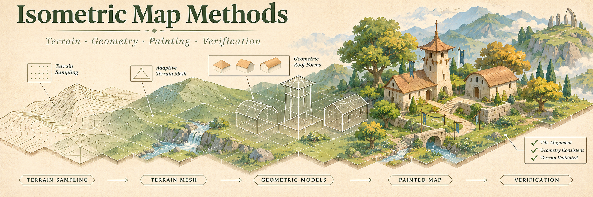
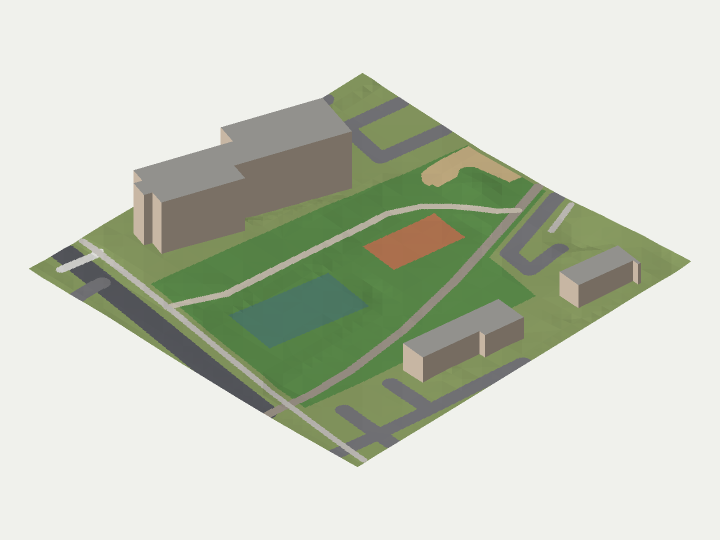

# Isometric Map Methods



Reusable methods for turning terrain and geometry into an aligned, illustrated isometric map. This repository shares algorithms, verification methods, public source references and reusable agent workflows developed during a campus-map project.

**Methods, plus one small open-data sample.** No campus datasets, real building models, directory records, map tiles, operational endpoints or deployment are included. The banner is fictional. The method tests create synthetic inputs. The one exception is a [hands-on tutorial](tutorial/README.md) on a deliberately small sample of public data (a neighbourhood park, 130 × 132 m, about 40 KB) in [`sample/`](sample/README.md). Its data stays under its own licences.

This is an independent methods reference, not an official NIH/NICHD product or endorsement.

## What you can use

| Module | Purpose |
| --- | --- |
| [terrain.mjs](methods/terrain.mjs) | Matching terrain edges across different leaf resolutions |
| [projection.mjs](methods/projection.mjs) | Orthographic projection and inverse at a known elevation |
| [roof.mjs](methods/roof.mjs) | Parametric saddle surface without a site-specific model |
| [motion.mjs](methods/motion.mjs) | Confirmed-fix animation with old and stale update guards |
| [raster.py](methods/raster.py) | Alignment, semantic compositing, bounded colour gains and overlap blending |
| [provenance.py](methods/provenance.py) | Immutable settings hashes and selected regular-file manifests |

These are small reference implementations. They do not include a complete map application, GIS ingestion stack, image-generation client or production orchestration.

## Try it on real ground

[`tutorial/`](tutorial/README.md) walks through four short scripts on the [sample](sample/README.md): bringing OpenStreetMap footprints, USA Structures heights and USGS terrain into one frame; a crack-free adaptive terrain mesh; blocks seated on sloping ground; and an isometric render with the published camera.

```bash
node tutorial/step1-load.mjs
node tutorial/step2-terrain.mjs
node tutorial/step3-buildings.mjs
node tutorial/step4-render.mjs   # writes tutorial/out/preview.png
```



*Tutorial preview from © OpenStreetMap contributors (ODbL), USA Structures: ORNL and FEMA Geospatial Response Office (CC BY 4.0), and U.S. Geological Survey 3DEP elevation (public domain).*

## Run the synthetic checks

Use Node.js 22+ and Python 3.12+. There are no JavaScript dependencies. NumPy is the only Python dependency.

```bash
python3 -m venv .venv
.venv/bin/python -m pip install -r requirements.txt
npm test
.venv/bin/python -B -m unittest discover -s method-tests -p 'test_*.py' -v
python3 -B publication/check.py --ref HEAD
```

No account, API key, GPU or network service is needed after dependency installation. `npm test` also runs the tutorial on the bundled sample.

```js
import {terrainMesh} from './methods/terrain.mjs';
import {camera} from './methods/projection.mjs';

const mesh = terrainMesh([{x: 0, y: 0, size: 4}], (x, y) => Math.sin(x) + y / 4);
const view = camera({heading: Math.PI / 4, scale: 2});
const screenVertices = mesh.vertices.map(p => view.project(p));
```

## Read the workflow

- [Methods and limits](public-docs/METHODS.md): terrain, geometry, guarded painting, stitching, motion and visual checks.
- [Hands-on tutorial](tutorial/README.md) and its [sample data](sample/README.md): three open datasets, their licences and attribution.
- [Public source references](public-docs/DATA_SOURCES.md): source roles and attribution.
- [Reproducibility](public-docs/REPRODUCIBILITY.md): inputs, settings, resume rules and validation.
- [Publication boundary](public-docs/PUBLICATION.md): exact-file and history review.
- [Release method](public-docs/RELEASE_METHOD.md): one gated, reproducible release for site deployments, regenerated layers and publication.
- [Reusable skills](public-skills/README.md): terrain review, guarded painting and methods publication.
- [Banner provenance](public-docs/BANNER.md): fictional illustration and prompt.

## Licence and contributions

Code and documentation use [Apache-2.0](LICENSE). It does not grant rights to external datasets or institutional names and marks. The files in `sample/` keep their own licences (ODbL, CC BY 4.0, public domain), and so does anything rendered from them, including `tutorial/preview.png`. See [sample/README.md](sample/README.md). The AI-generated banner is included under the same repository licence to the extent rights are available; no exclusive copyright claim is made for AI-generated content.

See [CONTRIBUTING.md](CONTRIBUTING.md) and [SECURITY.md](SECURITY.md). Contributions must use synthetic examples or the bundled sample, and must not include real campus or personnel data.
