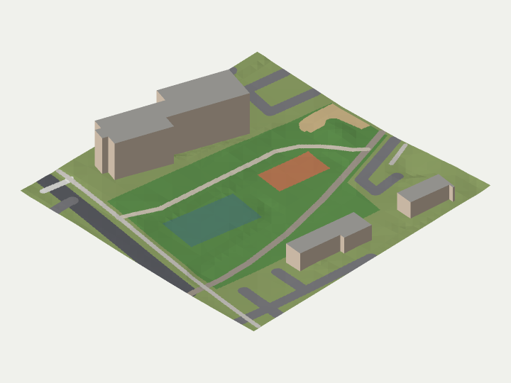

# Hands-on tutorial: from three open datasets to an isometric block model

This tutorial uses the methods in this repository on a small piece of real ground. The area is about 130 × 132 m around a neighbourhood park in Bethesda, Maryland, with:

- three apartment buildings;
- the park, a basketball court, a tennis court and part of a playground;
- a rail trail, footpaths, service drives and a street.

The data is in [`../sample/`](../sample/README.md) (about 40 KB). It comes from three public sources, each under its own licence. Read the [sample README](../sample/README.md) before reusing it.



*Rendered by step 4 from OpenStreetMap data (© OpenStreetMap contributors, ODbL), USA Structures heights (ORNL and FEMA Geospatial Response Office, CC BY 4.0) and USGS 3DEP elevation (public domain).*

You need Node.js 22 or newer and nothing else: no packages, network, GPU or API keys. Each step is a short script you can read in a few minutes. The shared helpers are in [`lib.mjs`](lib.mjs).

```bash
node tutorial/step1-load.mjs
node tutorial/step2-terrain.mjs
node tutorial/step3-buildings.mjs
node tutorial/step4-render.mjs        # writes tutorial/out/preview.png
```

`npm test` runs the same pipeline and compares it with [`expected.json`](expected.json) and `preview.png`.

## Step 1: one frame for three datasets

`step1-load.mjs` reads the three layers:

- **OpenStreetMap features** (`features.geojson`): footprints, park areas, courts, roads and paths, as WGS84 longitude and latitude.
- **USA Structures footprints** (`structures.geojson`): footprints with published heights, also longitude and latitude.
- **USGS terrain** (`terrain.json`): bare-earth heights on a 2 m grid of nodes, in metres east and north of a stated origin. Heights are NAVD88 metres.

The first job is to bring everything into one metric frame. The sample uses a local tangent plane: `x = (lon − lon0)·kx`, `y = (lat − lat0)·ky`, where `kx` and `ky` are the WGS84 metres per degree at the origin. Over 130 m this is accurate to well under a centimetre, so plain metres are safe for everything that follows. The script prints the extents and confirms that every feature lies inside the terrain grid.

**Try it.** The terrain's horizontal datum is NAD83, while OpenStreetMap uses WGS84. In this region the two differ by about 1 to 1.5 m. Shift all features 1.3 m east in `localFeatures` and watch where the paths land in step 4. Small datum mismatches are a common cause of roads that seem to "climb" kerbs.

## Step 2: an adaptive terrain mesh without cracks

A 2 m grid has 66 × 67 cells, which is 8,844 triangles. Flat ground does not need that many. `quadLeaves` starts from one big square and splits a square only while the bilinear surface through its four corners misses one of the grid nodes inside it by more than a tolerance (0.25 m by default). Flat lawn ends up as big leaves, and the slopes and kerbs as small ones.

Where a big leaf meets small ones, the small leaves have corners in the middle of the big leaf's edge. If the big leaf were cut into two triangles, those mid-edge points would not be vertices of the big leaf. After any vertical lift (terrain exaggeration, a different height sample), a hairline crack would open along the edge.

[`terrainMesh`](../methods/terrain.mjs) avoids this. It gathers every leaf corner and adds the neighbours' corners on each boundary to the big leaf's outline. It then fans triangles from the leaf centre. Step 2 checks the result: every interior edge must be shared by exactly two triangles.

```text
node tutorial/step2-terrain.mjs --tolerance=0.25
node tutorial/step2-terrain.mjs --tolerance=0.05
```

**Try it.**

- Compare triangle counts at several tolerances. Below some tolerance the adaptive mesh has *more* triangles than the plain grid, because each leaf is a fan of at least four. Adaptivity only pays where the ground allows big leaves.
- Copy `terrainMesh` and make each leaf use only its four corners (two triangles). Run the edge check: the cracks appear wherever leaf sizes change.

## Step 3: footprints, heights and a base that follows the ground

`makeBuildings` combines two datasets. OpenStreetMap supplies the shape. Its footprints are hand-drawn and usually match the building best, but they rarely have heights. USA Structures supplies heights, from a separate machine-extracted footprint set. The two are joined by area overlap: an OSM building takes the height of the structure covering at least half of it. Without a match it falls back to `building:levels` × 3 m, and then to a default.

On sloping ground, a flat-bottomed block either floats on the downhill side or is buried on the uphill side. The script measures the ground along each wall:

- the **pad** (roof base) is the 90th percentile of that wall-line ground, so the block is not buried uphill;
- the walls continue down to the lowest point, so it does not float downhill.

The table shows how far the ground falls along each building's walls.

The script also lists structures that match no OSM building. Look at the one it reports. It sits inside the park on top of the tennis court, has no height, and is "Unclassified". Machine-extracted footprint sets can mistake courts, decks and tanks for buildings. Joining two independent sources is how you catch that.

**Try it.**

- Run `node tutorial/step3-buildings.mjs --heights=levels` and compare: 6 levels × 3 m = 18 m against the published 17.4 m for the tall building. The two small buildings have no levels tag, so they fall back to the 6 m default.
- Change the pad from the 90th percentile to the median. Which wall gets buried?

## Step 4: one camera, a z-buffer and a picture

[`camera`](../methods/projection.mjs) is an orthographic projection with a heading and a tilt. The default tilt is `atan(1/√2)` ≈ 35.264°, true isometric. Step 4 uses heading 45°, so you look from the north-east. It projects every terrain and building triangle, keeps the nearest surface per pixel (a z-buffer), and remembers which world point each pixel shows.

Ground colour comes from the features at that exact point, not from the 2 m mesh. That is why the 2.4 m-wide paths stay crisp on a coarse mesh. Faces are shaded by their angle to a light from the viewer's right. The picture is drawn at twice the size and averaged down to smooth the edges. The PNG encoder writes only image data, with no metadata chunks.

```text
node tutorial/step4-render.mjs --heading=225          # from the south-west
node tutorial/step4-render.mjs --exaggeration=3       # make the 5.5 m of relief visible
```

The last line of step 4 shows why the inverse projection needs a height. A roof corner projects to a pixel and comes back exactly when unprojected at the roof's height. The same pixel unprojected 10 m lower lands about 14 m away. To pick objects from an isometric image, keep a height (or an object-ID image) for every pixel.

**Try it.**

- Add shadows: render a depth image from the light's direction and darken pixels that are behind it.
- Drape the roads by lowering the terrain under them to a smooth profile, then compare kerb heights.
- Add a second view and check that the same world point lands at the predicted pixel in both.

## What this tutorial is not

This is a block model: flat roofs, extruded walls and no facade detail. It is not a survey product. The terrain and footprints come from different surveys and dates, and the heights are as published (marked "Unverified" in the source). Read [`../public-docs/METHODS.md`](../public-docs/METHODS.md) for the limits of each method. Read the sample README for each dataset's date, licence and required attribution.
